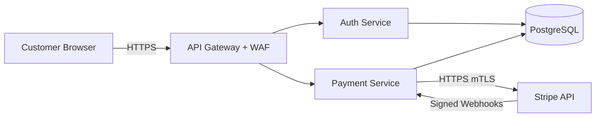

# 💳 Fintech Payment API — Threat Model


An end-to-end threat model for **PayFlow**, a fictitious fintech payment platform. It uses three industry-standard frameworks, **STRIDE**, **MITRE ATT&CK** and the **Lockheed Martin Cyber Kill Chain**, to find, rank and mitigate threats against a system that handles cardholder data and money movement.

> 🎯 **Why this project?** Threat modelling is a core skill for Security Engineers, AppSec Engineers and Security Architects. This repo shows the full process, from architecture decomposition through to a risk register with owners and due dates. That is what a real security team delivers.

---

## 📑 Table of Contents

| # | Section | What's inside |
|---|---------|---------------|
| 1 | [System Overview](docs/01-system-overview.md) | Components, architecture diagram, trust boundaries, data flows |
| 2 | [STRIDE Analysis](docs/02-stride-analysis.md) | 18 threats across all 6 STRIDE categories + risk matrix |
| 3 | [MITRE ATT&CK Mapping](docs/03-mitre-attack-mapping.md) | 15 real ATT&CK techniques with detections and mitigations |
| 4 | [Cyber Kill Chain](docs/04-cyber-kill-chain.md) | Two scenarios: external credential stuffing and malicious insider |
| 5 | [Attack Trees](docs/05-attack-trees.md) | "Compromise Payment Data" and "Account Takeover" trees |
| 6 | [Security Controls](docs/06-security-controls.md) | Threat → ATT&CK → Control → Owner mapping by domain |
| 7 | [Risk Register](docs/07-risk-register.md) | 14 scored risks with inherent and residual risk |
| — | [`threat-model.json`](threat-model.json) | Machine-readable threat model for tooling and automation |

---

## 🏗️ System Under Review

**PayFlow** lets customers store payment methods, send peer-to-peer payments and pay merchants. It is built from:

```
React SPA  →  API Gateway  →  Python (FastAPI) Auth & Payment Services  →  PostgreSQL
                                              ↓
                                   Stripe (external payment gateway)
```

| Component | Technology | Sensitivity |
|-----------|-----------|-------------|
| Web Client | React SPA (browser) | Untrusted |
| API Gateway | NGINX / AWS API Gateway + WAF | Edge |
| Auth Service | Python 3.12, FastAPI, JWT, TOTP MFA | High |
| Payment Service | Python 3.12, FastAPI, Celery workers | Critical |
| Database | PostgreSQL 16 (encrypted at rest) | Critical |
| External Gateway | Stripe API + webhooks | Third party |

See the full [architecture diagram](docs/01-system-overview.md).



---

## 🔍 Methodology

1. **Decompose** the system into components, data flows and trust boundaries (DFD).
2. **Identify threats** per component using **STRIDE**.
3. **Map to real adversary behaviour** using **MITRE ATT&CK** techniques.
4. **Model attack progression** end to end with the **Cyber Kill Chain**.
5. **Break down attacker goals** with **attack trees**.
6. **Define controls** and assign owners.
7. **Score and track** inherent and residual risk in a **risk register** (Likelihood × Impact, 1–25).

### Risk scoring

| Score | Rating | SLA |
|-------|--------|-----|
| 20–25 | 🔴 Critical | Fix before release |
| 12–19 | 🟠 High | 30 days |
| 6–11 | 🟡 Medium | 90 days |
| 1–5 | 🟢 Low | Accept / backlog |

---

## 📊 Key Findings

- **Top risk:** Account takeover through credential stuffing against `/auth/login` (inherent score 20, Critical).
- **Top data risk:** IDOR / BOLA on `/payments/{id}` exposing other customers' transactions (OWASP API1:2023).
- **Top integrity risk:** Forged Stripe webhooks marking unpaid transactions as settled.
- **Insider risk:** A DBA with standing production access could exfiltrate PII without detection.
- After the proposed controls, **all Critical risks drop to Medium or Low** residual risk.

---

## 🛠️ How to Use / Extend

1. **Read** the docs in order (`docs/01` → `docs/07`). Each builds on the last.
2. **View diagrams** directly on GitHub (Mermaid renders natively) or paste them into [mermaid.live](https://mermaid.live).
3. **Automate** with `threat-model.json`, for example to fail a CI build when an open threat has a risk score ≥ 20:
   ```bash
   python3 -c "import json;t=json.load(open('threat-model.json'))['threats'];c=[x['id'] for x in t if x['risk_score']>=20 and x['status']!='Mitigated'];print(c);exit(1 if c else 0)"
   ```
4. **Adapt** it to your own system: replace the components in `01-system-overview.md`, then re-run STRIDE per element.
5. **Review** it every quarter or when the architecture changes (new endpoint, new third party, new data store).

---

## 📚 References

- [MITRE ATT&CK Enterprise Matrix](https://attack.mitre.org/matrices/enterprise/)
- [Microsoft STRIDE Threat Model](https://learn.microsoft.com/en-us/azure/security/develop/threat-modeling-tool-threats)
- [Lockheed Martin Cyber Kill Chain](https://www.lockheedmartin.com/en-us/capabilities/cyber/cyber-kill-chain.html)
- [OWASP API Security Top 10 (2023)](https://owasp.org/API-Security/editions/2023/en/0x11-t10/)
- [PCI DSS v4.0](https://www.pcisecuritystandards.org/)
- [OWASP Threat Modeling Cheat Sheet](https://cheatsheetseries.owasp.org/cheatsheets/Threat_Modeling_Cheat_Sheet.html)

---

> ⚠️ **Disclaimer:** PayFlow is a fictitious system built for education and portfolio purposes. Any resemblance to a real product is coincidental.
