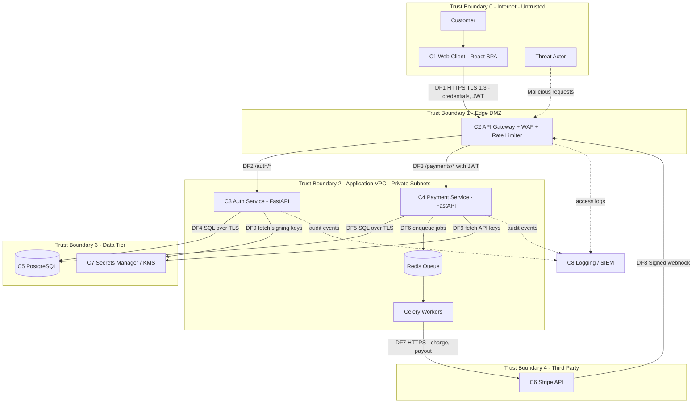

# 01 — System Overview

[⬅ Back to README](../README.md) | [Next: STRIDE Analysis ➡](02-stride-analysis.md)

## Scope

**In scope:** customer-facing web client, API gateway, Auth Service, Payment Service, PostgreSQL database, Stripe integration (outbound API calls and inbound webhooks), CI/CD-deployed container workloads.

**Out of scope:** Stripe's internal infrastructure, corporate IT (email, laptops), and physical security of the cloud provider.

## Components

| ID | Component | Description | Technology | Data Handled |
|----|-----------|-------------|------------|--------------|
| C1 | **Web Client** | Single-page app where customers log in, manage cards and send payments | React, served from CDN | Credentials (in transit), session tokens |
| C2 | **API Gateway** | Single public entry point. TLS termination, WAF, rate limiting, request routing | AWS API Gateway + WAF / NGINX | All API traffic |
| C3 | **Auth Service** | Registration, login, MFA, JWT issuance and refresh, password reset | Python 3.12, FastAPI, Argon2id, PyJWT | Password hashes, MFA secrets, refresh tokens |
| C4 | **Payment Service** | Creates payment intents, transfers funds, handles refunds, processes webhooks | Python 3.12, FastAPI, Celery, Redis | Transaction records, Stripe tokens, balances |
| C5 | **Database** | Primary system of record | PostgreSQL 16, AES-256 at rest, private subnet | PII, account balances, transaction ledger, audit log |
| C6 | **External Stripe API** | Card tokenisation, charges, payouts. Sends webhooks back to PayFlow | Stripe REST API | Card data (PAN never touches PayFlow), payment status |
| C7 | **Secrets Manager** | Stores DB credentials, Stripe keys, JWT signing keys | AWS Secrets Manager / KMS | Cryptographic material |
| C8 | **Logging / SIEM** | Centralised logs and alerting | CloudWatch → SIEM | Audit events, security telemetry |

## Architecture & Data Flow Diagram

## Trust Boundaries

| ID | Boundary | Crossing Points | Key Control |
|----|----------|-----------------|-------------|
| TB0 → TB1 | Internet → Edge | DF1, DF8 | TLS 1.3, WAF, rate limits, bot detection |
| TB1 → TB2 | Edge → Application | DF2, DF3 | JWT validation, mTLS between gateway and services |
| TB2 → TB3 | Application → Data | DF4, DF5, DF9 | IAM roles, least-privilege DB users, TLS |
| TB2 → TB4 | Application → Third party | DF7 | Restricted Stripe keys, egress allow-list |
| TB4 → TB1 | Third party → Edge | DF8 | Stripe-Signature HMAC verification, replay window |

## Data Flow Table

| Flow | Source | Destination | Data | Protocol | Classification |
|------|--------|-------------|------|----------|----------------|
| DF1 | Web Client | API Gateway | Username, password, MFA code, JWT, payment requests | HTTPS (TLS 1.3) | Confidential |
| DF2 | API Gateway | Auth Service | Login and registration payloads | HTTPS (mTLS) | Confidential |
| DF3 | API Gateway | Payment Service | Payment requests, bearer JWT | HTTPS (mTLS) | Restricted |
| DF4 | Auth Service | PostgreSQL | User records, Argon2id hashes, refresh tokens | PostgreSQL wire + TLS | Restricted |
| DF5 | Payment Service | PostgreSQL | Ledger entries, balances, Stripe customer IDs | PostgreSQL wire + TLS | Restricted |
| DF6 | Payment Service | Redis | Job payloads (transaction IDs only, no PII) | Redis TLS | Internal |
| DF7 | Celery Worker | Stripe | PaymentIntent, payout requests | HTTPS | Restricted |
| DF8 | Stripe | API Gateway | Payment status events | HTTPS + HMAC signature | Confidential |
| DF9 | Services | Secrets Manager | DB creds, Stripe secret key, JWT private key | AWS SDK over HTTPS | Secret |

## Assets

| Asset | Why it matters | CIA priority |
|-------|----------------|--------------|
| Customer credentials and MFA secrets | Lead to account takeover | **C**onfidentiality |
| Transaction ledger and balances | Money movement, regulatory reporting | **I**ntegrity |
| PII (name, address, DOB, email) | GDPR, fraud, identity theft | **C**onfidentiality |
| Stripe secret key | Full control of merchant account | **C**onfidentiality |
| JWT signing key | Forging any user's identity | **C**onfidentiality / **I**ntegrity |
| Payment API availability | Revenue, customer trust | **A**vailability |

## Assumptions

1. Card PANs are tokenised client-side by Stripe Elements. PayFlow never stores raw card data, which keeps PCI DSS scope at SAQ A-EP.
2. All services run as containers on AWS ECS Fargate in private subnets.
3. Engineers access production only through SSO and a bastion with session recording.
4. Threat actors include opportunistic fraudsters, organised cybercrime groups and malicious insiders.
