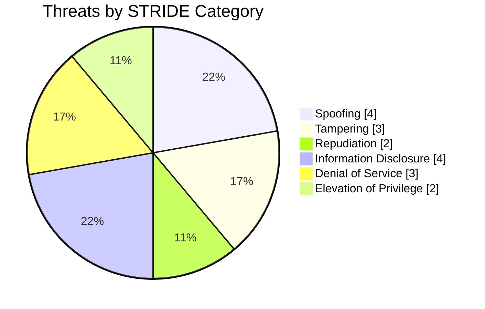
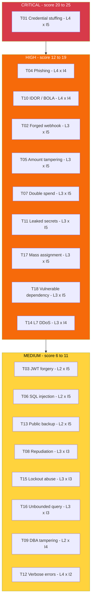

# 02 — STRIDE Analysis

[⬅ System Overview](01-system-overview.md) | [Next: MITRE ATT&CK Mapping ➡](03-mitre-attack-mapping.md)

STRIDE was applied **per element** of the data flow diagram. Every component and data flow in [01-system-overview.md](01-system-overview.md) was checked against all six categories.

| Letter | Category | Property violated |
|--------|----------|-------------------|
| **S** | Spoofing | Authentication |
| **T** | Tampering | Integrity |
| **R** | Repudiation | Non-repudiation |
| **I** | Information Disclosure | Confidentiality |
| **D** | Denial of Service | Availability |
| **E** | Elevation of Privilege | Authorisation |

**Scoring:** Likelihood (1–5) × Impact (1–5) = Risk score. 20–25 Critical, 12–19 High, 6–11 Medium, 1–5 Low.

## Threat Table

| ID | Threat Category | Component | Threat Description | Impact | Likelihood | Risk Rating | Mitigation |
|----|-----------------|-----------|--------------------|:------:|:----------:|-------------|------------|
| T01 | Spoofing | Auth Service | Credential stuffing with breached username and password lists against `/auth/login` leads to account takeover | 5 | 4 | 🔴 Critical (20) | Mandatory TOTP/WebAuthn MFA, per-IP and per-account rate limits, breached-password check (HIBP k-anonymity), bot detection at WAF |
| T02 | Spoofing | Payment Service | Forged Stripe webhook sent to `/webhooks/stripe` marks an unpaid payment as `succeeded` | 5 | 3 | 🟠 High (15) | Verify `Stripe-Signature` HMAC with endpoint secret, 5-minute timestamp tolerance, re-fetch event from Stripe API before acting |
| T03 | Spoofing | Auth Service | JWT forged with `alg: none` or HS256/RS256 key confusion | 5 | 2 | 🟡 Medium (10) | Pin algorithm to RS256 in PyJWT `decode(algorithms=["RS256"])`, validate `iss`, `aud`, `exp`, rotate keys through KMS |
| T04 | Spoofing | Web Client | Phishing site clones the PayFlow login page and harvests credentials and OTP codes | 4 | 4 | 🟠 High (16) | Phishing-resistant WebAuthn passkeys, DMARC/SPF/DKIM `p=reject`, brand monitoring and takedown |
| T05 | Tampering | Payment Service | Client changes `amount` or `currency` in the payment request body after the UI calculates it | 5 | 3 | 🟠 High (15) | Compute amounts server-side from order ID, Pydantic schema validation, ignore client-supplied prices |
| T06 | Tampering | Database | SQL injection through the transaction search filter changes ledger rows | 5 | 2 | 🟡 Medium (10) | Parameterised queries via SQLAlchemy ORM, no raw string SQL, Semgrep rule in CI, least-privilege DB user |
| T07 | Tampering | Payment Service | Race condition (double-spend) when two concurrent transfer requests debit the same balance | 5 | 3 | 🟠 High (15) | `SELECT ... FOR UPDATE` row locking, idempotency keys, DB CHECK constraint `balance >= 0` |
| T08 | Repudiation | Payment Service | Customer disputes a transfer and no tamper-evident log proves who started it | 3 | 3 | 🟡 Medium (9) | Append-only audit log with user ID, IP, device fingerprint, request ID. Ship to WORM storage (S3 Object Lock) |
| T09 | Repudiation | Database | Privileged DBA changes balances directly and the change is not attributable | 4 | 2 | 🟡 Medium (8) | pgAudit, named DB accounts via SSO (no shared `postgres` user), dual approval for production writes |
| T10 | Information Disclosure | Payment Service | Broken Object Level Authorisation (IDOR): `GET /payments/{id}` returns another customer's transaction | 4 | 4 | 🟠 High (16) | Enforce `owner_id == current_user.id` in every query, UUIDv4 IDs, automated authz tests per endpoint |
| T11 | Information Disclosure | Payment Service | Stripe secret key or DB password hard-coded in source or leaked in logs | 5 | 3 | 🟠 High (15) | Secrets Manager only, Gitleaks pre-commit and CI scanning, log redaction filter, restricted Stripe keys |
| T12 | Information Disclosure | API Gateway | Verbose error responses (stack traces) reveal framework versions and internal hostnames | 2 | 4 | 🟡 Medium (8) | Generic error handler in FastAPI, `debug=False`, strip `Server` headers |
| T13 | Information Disclosure | Database | Unencrypted backup snapshot shared publicly or copied to a personal account | 5 | 2 | 🟡 Medium (10) | KMS-encrypted snapshots, SCP denying public sharing, AWS Config rule alerting |
| T14 | Denial of Service | API Gateway | Layer-7 flood against `/payments` exhausts API workers | 4 | 3 | 🟠 High (12) | AWS Shield, WAF rate-based rules, autoscaling, request size limits |
| T15 | Denial of Service | Auth Service | Attacker deliberately triggers account lockouts for many customers | 3 | 3 | 🟡 Medium (9) | Progressive delays and CAPTCHA instead of hard lockout, per-IP throttling |
| T16 | Denial of Service | Payment Service | Expensive unbounded queries (`?limit=1000000`) exhaust DB connections | 3 | 3 | 🟡 Medium (9) | Enforce pagination max 100, query timeouts, connection pool limits |
| T17 | Elevation of Privilege | Auth Service | Mass assignment: user sends `"role": "admin"` in a profile update and becomes admin | 5 | 3 | 🟠 High (15) | Separate Pydantic input models with explicit allow-listed fields, RBAC checks on admin routes |
| T18 | Elevation of Privilege | Payment Service | Vulnerable dependency in the container (for example an RCE in a Python library) gives shell access | 5 | 3 | 🟠 High (15) | Trivy image scans blocking High/Critical, Dependabot, distroless non-root images, read-only filesystem |

**Totals:** 18 threats. 1 Critical, 9 High, 8 Medium.

## Distribution by Category

## Risk Matrix

Threats placed by **Likelihood** (rows) and **Impact** (columns):

| Likelihood ↓ / Impact → | 1 | 2 | 3 | 4 | 5 |
|---|---|---|---|---|---|
| **5** | | | | | |
| **4** | | T12 | | T04, T10 | **T01** |
| **3** | | | T08, T15, T16 | T14 | T02, T05, T07, T11, T17, T18 |
| **2** | | | | T09 | T03, T06, T13 |
| **1** | | | | | |

## Key Takeaways

1. **Identity is the main attack surface.** Spoofing threats (T01, T04) carry the highest likelihood because credential reuse is everywhere.
2. **Authorisation bugs (T10, T17) are the most likely route to a data breach.** They match OWASP API1 and API3 (2023).
3. **Money-movement integrity (T02, T05, T07)** needs server-side enforcement. Never trust the client or unsigned callbacks.
4. **Supply chain (T18)** is covered by the CI/CD pipeline controls (Trivy + Semgrep) in a companion project.
