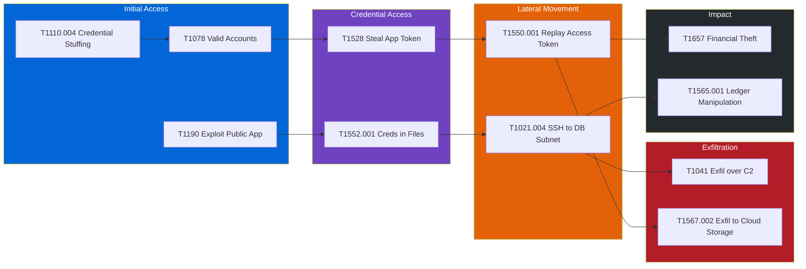

# 03 — MITRE ATT&CK Mapping

[⬅ STRIDE Analysis](02-stride-analysis.md) | [Next: Cyber Kill Chain ➡](04-cyber-kill-chain.md)

This section maps the STRIDE threats to real adversary behaviour from the **MITRE ATT&CK Enterprise matrix (v15)**. The mapping links design-level threats to detection engineering, so the SOC knows what to look for and which logs prove it.

## Technique Mapping

| ATT&CK ID | Technique Name | Tactic | Threat Scenario (STRIDE ref) | Detection | Mitigation |
|-----------|----------------|--------|------------------------------|-----------|------------|
| [T1190](https://attack.mitre.org/techniques/T1190/) | Exploit Public-Facing Application | Initial Access | SQL injection or vulnerable dependency in the FastAPI service (T06, T18) | WAF SQLi rule hits, 5xx spikes, anomalous DB query patterns | M1048 Application Isolation, M1050 Exploit Protection, M1051 Update Software |
| [T1078](https://attack.mitre.org/techniques/T1078/) | Valid Accounts | Initial Access | Attacker logs in with stuffed credentials (T01) | Login from new ASN or country plus a new device, impossible-travel alerts | M1032 Multi-factor Authentication, M1036 Account Use Policies |
| [T1566.002](https://attack.mitre.org/techniques/T1566/002/) | Phishing: Spearphishing Link | Initial Access | Lookalike domain harvests customer or employee credentials (T04) | Newly registered lookalike domains, DMARC aggregate reports | M1054 Software Configuration (DMARC), M1017 User Training |
| [T1195.002](https://attack.mitre.org/techniques/T1195/002/) | Supply Chain Compromise: Software Supply Chain | Initial Access | Malicious or typosquatted PyPI package pulled into the build (T18) | SBOM diff in CI, Trivy/OSV alerts, unexpected outbound connections from build runners | M1016 Vulnerability Scanning, M1051 Update Software |
| [T1110.004](https://attack.mitre.org/techniques/T1110/004/) | Brute Force: Credential Stuffing | Credential Access | High-volume login attempts from a botnet (T01) | Failed-login ratio per IP/ASN, many usernames per IP | M1032 MFA, M1027 Password Policies, M1036 Account Use Policies |
| [T1552.001](https://attack.mitre.org/techniques/T1552/001/) | Unsecured Credentials: Credentials In Files | Credential Access | Stripe secret key committed to Git or baked into a container image (T11) | Gitleaks in CI, GitHub secret scanning push protection | M1047 Audit, M1022 Restrict File and Directory Permissions |
| [T1528](https://attack.mitre.org/techniques/T1528/) | Steal Application Access Token | Credential Access | JWT or refresh token stolen through XSS or logs (T03) | Same token used from two IPs or devices at once | M1013 Application Developer Guidance, short token TTL, token binding |
| [T1550.001](https://attack.mitre.org/techniques/T1550/001/) | Use Alternate Authentication Material: Application Access Token | Lateral Movement | Stolen JWT replayed to call `/payments` as the victim (T03, T10) | Token used outside its originating session fingerprint | M1018 User Account Management, refresh-token rotation |
| [T1021.004](https://attack.mitre.org/techniques/T1021/004/) | Remote Services: SSH | Lateral Movement | Compromised engineer pivots from bastion into the DB subnet (T09) | Bastion session recordings, SSH outside change windows | M1032 MFA, M1035 Limit Access to Resource Over Network |
| [T1530](https://attack.mitre.org/techniques/T1530/) | Data from Cloud Storage | Collection | Attacker reads DB snapshots or audit logs from a misconfigured S3 bucket (T13) | CloudTrail `GetObject` from an unknown principal, Macie alerts | M1037 Filter Network Traffic, M1041 Encrypt Sensitive Information |
| [T1567.002](https://attack.mitre.org/techniques/T1567/002/) | Exfiltration Over Web Service: Exfiltration to Cloud Storage | Exfiltration | Insider uploads a customer PII export to personal cloud storage (insider scenario) | DLP and CASB alerts, large egress from DB admin workstation | M1021 Restrict Web-Based Content, M1057 Data Loss Prevention |
| [T1041](https://attack.mitre.org/techniques/T1041/) | Exfiltration Over C2 Channel | Exfiltration | Implant in a compromised container sends data to an attacker server | VPC Flow Logs to unknown destinations, egress firewall denies | M1031 Network Intrusion Prevention, egress allow-list |
| [T1565.001](https://attack.mitre.org/techniques/T1565/001/) | Data Manipulation: Stored Data Manipulation | Impact | Ledger balances changed through SQLi or a rogue DBA (T06, T09) | pgAudit diffs, daily ledger reconciliation against Stripe | M1029 Remote Data Storage, M1041 Encrypt Sensitive Information |
| [T1657](https://attack.mitre.org/techniques/T1657/) | Financial Theft | Impact | Fraudulent transfers or payouts after account takeover (T01, T05, T07) | Fraud scoring, velocity rules, new-payee-plus-large-amount alerts | Step-up MFA for new payees, payout holds |
| [T1499.003](https://attack.mitre.org/techniques/T1499/003/) | Endpoint Denial of Service: Application Exhaustion Flood | Impact | Layer-7 flood on payment endpoints (T14, T16) | Request rate per route, p99 latency, worker saturation | M1037 Filter Network Traffic, rate limiting, Shield Advanced |

**Total: 15 techniques across 6 tactics** (Initial Access, Credential Access, Lateral Movement, Collection, Exfiltration, Impact).

## Attack Chain: External Adversary



**Path 1 (account takeover → fraud):** T1110.004 → T1078 → T1528 → T1550.001 → T1657

**Path 2 (application exploit → breach):** T1190 → T1552.001 → T1021.004 → T1041 / T1565.001

## Detection Coverage

| Tactic | Techniques mapped | Log sources required | Coverage |
|--------|------------------|----------------------|----------|
| Initial Access | 4 | WAF logs, Auth Service logs, CI logs | 🟢 Good |
| Credential Access | 3 | Auth logs, Gitleaks, GitHub secret scanning | 🟢 Good |
| Lateral Movement | 2 | Bastion recordings, token telemetry | 🟡 Partial: token replay detection needs device binding |
| Collection | 1 | CloudTrail, Macie | 🟢 Good |
| Exfiltration | 2 | VPC Flow Logs, DLP | 🟡 Partial: DLP on admin endpoints is not yet deployed |
| Impact | 3 | Fraud engine, pgAudit, reconciliation job | 🟢 Good |

## Example Detection Rule (Sigma-style)

```yaml
title: Credential Stuffing Against PayFlow Login
id: 7d1c2b3e-payflow-t1110-004
status: experimental
logsource:
  product: payflow
  service: auth
detection:
  selection:
    event: login_failed
  timeframe: 5m
  condition: selection | count(distinct username) by src_ip > 20
level: high
tags:
  - attack.credential_access
  - attack.t1110.004
```
