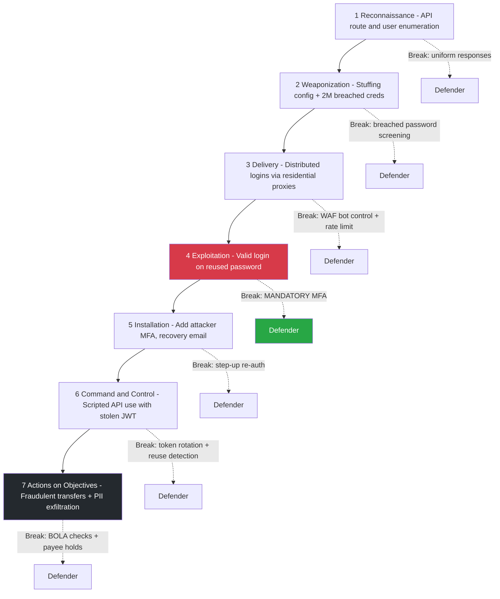
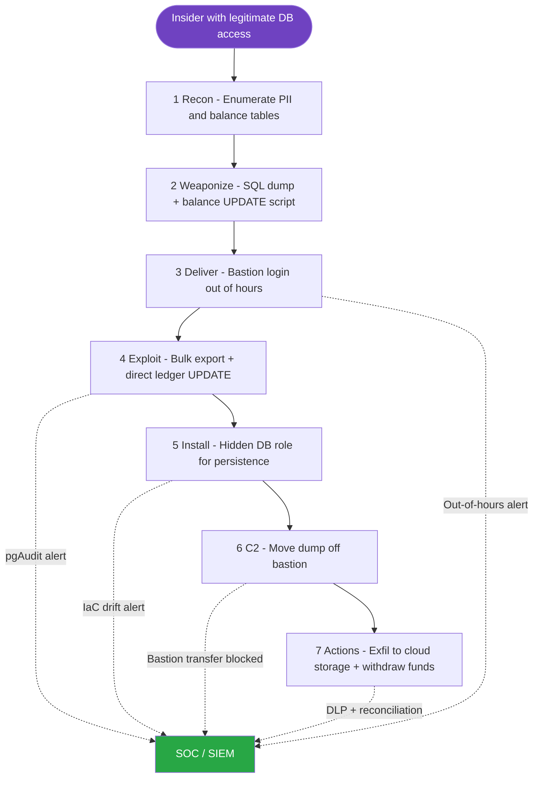

# 04 — Cyber Kill Chain

[⬅ MITRE ATT&CK Mapping](03-mitre-attack-mapping.md) | [Next: Attack Trees ➡](05-attack-trees.md)

The **Lockheed Martin Cyber Kill Chain** splits an intrusion into 7 stages. Breaking **any** link stops the attack, so the defender's job is to put controls and detections at as many stages as possible, ideally early.

## Scenario 1: Credential Stuffing → API Abuse → Data Exfiltration

**Threat actor:** organised fraud group with access to combo lists from public breaches and a residential-proxy botnet.
**Objective:** take over PayFlow accounts, drain balances to mule accounts and harvest PII to resell.

| # | Stage | Attacker Action | Defender Control | Detection Opportunity |
|---|-------|-----------------|------------------|-----------------------|
| 1 | **Reconnaissance** | Enumerates API routes from the React bundle, tests `/auth/register` for user-enumeration responses, reads public docs | Minified bundles with no internal routes, identical responses for "user exists" and "user not found", no public Swagger in prod | Spike in 404s and OPTIONS requests from a single ASN, scraping user agents |
| 2 | **Weaponization** | Builds an OpenBullet/SilverBullet config for the PayFlow login flow and loads 2M breached credential pairs | Breached-password screening at registration and reset (HIBP), so reused passwords are rejected up front | Threat intel: PayFlow config shared on fraud forums, brand monitoring |
| 3 | **Delivery** | Sends distributed login requests through 50k residential proxy IPs | WAF bot control, per-IP and per-account rate limits, device fingerprinting, CAPTCHA after anomalies | Failed-login ratio > 90% per ASN, many distinct usernames per device fingerprint |
| 4 | **Exploitation** | Successful logins on accounts that reuse passwords and lack MFA (T1078) | **Mandatory MFA** (TOTP/WebAuthn). This is the single most effective break in the chain | Successful login from a new device plus a new country plus a recent failure burst |
| 5 | **Installation** | Adds attacker email or phone as recovery method, registers a new device, generates a long-lived refresh token | Step-up re-authentication to change email, phone, MFA or add a payee. Notifications to the original email | Account-settings change within minutes of a risky login |
| 6 | **Command & Control** | Scripts use the stolen JWT/refresh token to call `/payments` and `/users/me` automatically | Short JWT TTL (10 min), refresh-token rotation with reuse detection, token bound to device | Same refresh token used twice (reuse detection), API calls with a scripting user agent |
| 7 | **Actions on Objectives** | Transfers balance to mule accounts (T1657), scrapes PII via IDOR on `/payments/{id}` (T10), exfiltrates data | Object-level authz checks, transfer velocity limits, 24h hold on new payees, fraud scoring | Fraud engine: new payee plus max amount, sequential ID access pattern, high data volume per session |

## Scenario 2: Malicious Insider (Database Administrator)

**Threat actor:** a disgruntled DBA with legitimate production read access who plans to leave and sell customer data.
**Objective:** export customer PII and quietly change balances in an account they control.

Insiders skip most of the early stages because they already have access. That is why **detection** and **least privilege** matter more here than perimeter controls.

| # | Stage | Attacker Action | Defender Control | Detection Opportunity |
|---|-------|-----------------|------------------|-----------------------|
| 1 | **Reconnaissance** | Queries `information_schema` to find PII and balance tables, checks which actions are logged | Data classification tags, PII columns in a separate schema with separate grants | Schema enumeration queries by a human account (not a service account) |
| 2 | **Weaponization** | Writes a SQL script to dump `users` and `kyc_documents` to CSV, and an `UPDATE` on `balances` | No standing write access: just-in-time (JIT) elevation with approval | JIT request without a linked change ticket |
| 3 | **Delivery** | Connects to production through the bastion outside normal hours | SSO + MFA bastion, session recording, access limited to change windows | Bastion login at 02:00 with no on-call incident |
| 4 | **Exploitation** | Runs `COPY users TO STDOUT` and the balance `UPDATE` | Column-level encryption on PII (app-layer keys the DBA cannot access), DB CHECK constraints | pgAudit: bulk SELECT on a PII table, any direct UPDATE on `balances` |
| 5 | **Installation** | Creates a hidden DB role for persistent access after leaving | Infrastructure-as-code drift detection, no `CREATEROLE` for humans | New DB role not created by Terraform → alert |
| 6 | **Command & Control** | Copies the dump to their laptop through the bastion clipboard or SCP | Bastion blocks file transfer and clipboard, managed devices only | Large outbound transfer from the bastion |
| 7 | **Actions on Objectives** | Uploads data to personal cloud storage (T1567.002), withdraws the inflated balance | DLP/CASB on corporate endpoints, daily ledger reconciliation against Stripe | DLP alert, reconciliation mismatch, leaver risk flag from HR |

## Lessons

| Insight | Scenario 1 (external) | Scenario 2 (insider) |
|---------|-----------------------|----------------------|
| Best break point | Stage 4: MFA | Stages 2 and 4: JIT access + column encryption |
| Main detection source | Auth logs, WAF, fraud engine | pgAudit, bastion recordings, DLP |
| Key principle | Defence in depth at the edge | Least privilege + separation of duties |
| Related STRIDE threats | T01, T03, T04, T10 | T09, T13, T08 |
