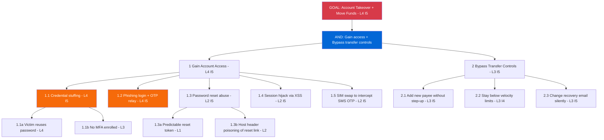

# 05 — Attack Trees

[⬅ Cyber Kill Chain](04-cyber-kill-chain.md) | [Next: Security Controls ➡](06-security-controls.md)

Attack trees break an attacker's **goal** (root) into the **ways to reach it** (branches and leaves). Child nodes are **OR** (any one is enough) unless marked **AND** (all are needed).

**Node labels:** `L` = Likelihood (1–5), `I` = Impact (1–5). The risk of a parent OR node is the highest-risk child.

## Tree 1: Compromise Payment Data

**Goal:** read or change PayFlow customer transaction and payment data.

```mermaid
flowchart TD
    ROOT["GOAL: Compromise Payment Data - L4 I5"]

    ROOT --> A["1 Exploit the API - L4 I5"]
    ROOT --> B["2 Attack the Database directly - L2 I5"]
    ROOT --> C["3 Abuse Stripe integration - L3 I5"]
    ROOT --> D["4 Compromise the supply chain - L3 I5"]

    A --> A1["1.1 IDOR on /payments/id - L4 I4"]
    A --> A2["1.2 SQL injection in search filter - L2 I5"]
    A --> A3["1.3 Mass assignment to admin role - L3 I5"]
    A --> A4["1.4 Replay stolen JWT - L3 I4"]

    B --> B1["2.1 Public DB snapshot - L2 I5"]
    B --> B2["2.2 Insider DBA bulk export - L2 I5"]
    B --> B3["2.3 AND: Steal DB creds + reach private subnet - L1 I5"]
    B3 --> B3a["2.3a Creds leaked in Git or logs - L3 I5"]
    B3 --> B3b["2.3b Pivot via compromised container - L2 I5"]

    C --> C1["3.1 Forge unsigned webhook - L3 I5"]
    C --> C2["3.2 Steal Stripe secret key - L2 I5"]
    C --> C3["3.3 Tamper amount before PaymentIntent - L3 I5"]

    D --> D1["4.1 Typosquatted PyPI package - L2 I5"]
    D --> D2["4.2 Known CVE in base image - L3 I5"]
    D --> D3["4.3 Compromised GitHub Action - L2 I5"]

    style ROOT fill:#d73a49,color:#fff
    style A fill:#f66a0a,color:#fff
    style A1 fill:#f66a0a,color:#fff
    style C1 fill:#f66a0a,color:#fff
    style D2 fill:#f66a0a,color:#fff
    style B3 fill:#0366d6,color:#fff
```

| Leaf | Countermeasure | STRIDE ref |
|------|----------------|------------|
| 1.1 IDOR | Owner check in every query, automated authz tests | T10 |
| 1.2 SQLi | SQLAlchemy ORM, Semgrep `python.lang.security.audit.formatted-sql-query` | T06 |
| 1.3 Mass assignment | Explicit Pydantic input models | T17 |
| 1.4 JWT replay | 10-minute TTL, device binding, rotation | T03 |
| 2.1 Public snapshot | SCP deny public snapshot sharing, KMS | T13 |
| 2.2 Insider | JIT access, pgAudit, column encryption | T09 |
| 2.3 Creds + pivot | Secrets Manager, Gitleaks, network segmentation | T11 |
| 3.1 Forged webhook | `stripe.Webhook.construct_event` signature check | T02 |
| 3.2 Stripe key theft | Restricted keys, key rotation, Secrets Manager | T11 |
| 3.3 Amount tamper | Server-side pricing | T05 |
| 4.x Supply chain | Trivy, pinned hashes (`pip --require-hashes`), Actions pinned to commit SHA | T18 |

**Highest-risk path:** `ROOT → 1 Exploit the API → 1.1 IDOR` (L4 × I4 = 16), then `3.1 Forged webhook`, `3.3 Amount tamper` and `4.2 Known CVE` (L3 × I5 = 15).

## Tree 2: Account Takeover

**Goal:** gain full control of a victim's PayFlow account and move money out.

| Leaf | Countermeasure | STRIDE / ATT&CK ref |
|------|----------------|---------------------|
| 1.1 Credential stuffing | Mandatory MFA, HIBP screening, bot control | T01 / T1110.004 |
| 1.2 Phishing + OTP relay | WebAuthn passkeys (phishing-resistant), DMARC reject | T04 / T1566.002 |
| 1.3 Reset abuse | 128-bit random single-use tokens, 15-minute expiry, hard-coded reset domain | T01 |
| 1.4 XSS session hijack | React auto-escaping, strict CSP, HttpOnly + SameSite cookies for refresh token | T03 / T1528 |
| 1.5 SIM swap | No SMS OTP for high-risk actions, TOTP/WebAuthn only | T01 |
| 2.1 New payee | Step-up MFA + 24h cooling-off for new payees | T1657 |
| 2.2 Velocity evasion | ML fraud scoring on behaviour, not just thresholds | T1657 |
| 2.3 Recovery change | Re-auth + notify old email + 48h hold on payouts after change | T01 |

**Key insight:** the root is an **AND** node. Even if access is gained (branch 1 is likely), strong transfer controls (branch 2) can still stop financial loss. That is defence in depth in practice.
