# 06 — Security Controls

[⬅ Attack Trees](05-attack-trees.md) | [Next: Risk Register ➡](07-risk-register.md)

Every threat from the STRIDE analysis maps to at least one **preventive** and one **detective** control. Controls are grouped by domain and prioritised by the inherent risk of the threats they address.

**Priority:** 🔴 Critical = before go-live · 🟠 High = within 30 days · 🟡 Medium = within 90 days

## Domain 1: Identity & Access Management

| Threat | MITRE ATT&CK | Control | Implementation | Owner | Priority |
|--------|--------------|---------|----------------|-------|----------|
| T01 Credential stuffing | T1110.004, T1078 | Mandatory MFA | TOTP via `pyotp` + WebAuthn via `py_webauthn`. Enrolment enforced at first login | Identity Team | 🔴 Critical |
| T01 Credential stuffing | T1110.004 | Breached password screening | HIBP Pwned Passwords k-anonymity API on register and reset | Identity Team | 🔴 Critical |
| T04 Phishing | T1566.002 | Phishing-resistant auth | WebAuthn passkeys offered as the default MFA | Identity Team | 🟠 High |
| T03 JWT forgery | T1528, T1550.001 | Hardened token handling | RS256 only, 10-min access TTL, refresh rotation with reuse detection, keys in KMS | AppSec | 🟠 High |
| T17 Mass assignment | T1068 | Strict input models + RBAC | Separate Pydantic `UserUpdateIn` model, `Depends(require_role("admin"))` on admin routes | Backend Team | 🟠 High |
| T10 IDOR / BOLA | T1078 | Object-level authorisation | Repository layer always filters by `owner_id`. Pytest authz matrix in CI | Backend Team | 🟠 High |
| T09 DBA tampering | T1021.004, T1565.001 | Just-in-time privileged access | No standing prod write. JIT elevation via approval workflow, 1h expiry | Platform Team | 🟠 High |

## Domain 2: Data Protection

| Threat | MITRE ATT&CK | Control | Implementation | Owner | Priority |
|--------|--------------|---------|----------------|-------|----------|
| T11 Leaked secrets | T1552.001 | Centralised secret management | AWS Secrets Manager + IAM task roles. No secrets in env files or images | Platform Team | 🔴 Critical |
| T11 Leaked secrets | T1552.001 | Secret scanning | Gitleaks pre-commit + CI, GitHub push protection | AppSec | 🔴 Critical |
| T13 Public backups | T1530 | Encryption + sharing guardrails | KMS CMK on RDS and snapshots, SCP denying `ModifyDBSnapshotAttribute` to `all` | Cloud Security | 🟠 High |
| T05 Amount tampering | T1565.001 | Server-side authority | Amounts derived from server-side order record. Client values ignored | Backend Team | 🟠 High |
| T07 Double-spend | T1657 | Transactional integrity | `SELECT ... FOR UPDATE`, idempotency keys, `CHECK (balance >= 0)` | Backend Team | 🟠 High |
| T06 SQL injection | T1190, T1565.001 | Safe data access | SQLAlchemy ORM / bound parameters only. Semgrep blocks f-string SQL | Backend Team | 🟠 High |
| PII exposure | T1567.002 | Field-level encryption | App-layer envelope encryption of DOB, address, KYC docs (KMS data keys) | AppSec | 🟡 Medium |

## Domain 3: Network & Application Security

| Threat | MITRE ATT&CK | Control | Implementation | Owner | Priority |
|--------|--------------|---------|----------------|-------|----------|
| T02 Forged webhook | T1190 | Webhook authenticity | `stripe.Webhook.construct_event()` with endpoint secret, 300s tolerance, re-fetch event | Payments Team | 🔴 Critical |
| T14 L7 DDoS | T1499.003 | Edge protection | AWS Shield + WAF rate-based rules (100 req/5 min/IP on `/auth`), autoscaling | Platform Team | 🟠 High |
| T16 Unbounded queries | T1499.003 | Resource limits | Pagination max 100, `statement_timeout = 5s`, pool size caps | Backend Team | 🟡 Medium |
| T18 Vulnerable dependency | T1195.002, T1190 | Supply chain security | Trivy + Semgrep in GitHub Actions blocking High/Critical, Dependabot, pinned hashes | DevSecOps | 🔴 Critical |
| T18 Container escape | T1190 | Hardened runtime | Distroless non-root images, read-only root FS, no `CAP_SYS_ADMIN` | Platform Team | 🟠 High |
| Lateral movement | T1021.004, T1041 | Network segmentation | Private subnets, security groups by service, egress allow-list (Stripe only) | Cloud Security | 🟠 High |
| T12 Verbose errors | T1190 | Error handling | Global FastAPI exception handler, `debug=False`, header stripping | Backend Team | 🟡 Medium |

## Domain 4: Monitoring, Logging & Response

| Threat | MITRE ATT&CK | Control | Implementation | Owner | Priority |
|--------|--------------|---------|----------------|-------|----------|
| T08 Repudiation | — | Tamper-evident audit log | Structured JSON audit events → S3 Object Lock (compliance mode, 7 years) | SecOps | 🟠 High |
| T09 DBA tampering | T1565.001 | Database activity monitoring | pgAudit → SIEM. Alert on bulk SELECT of PII and direct UPDATE on ledger | SecOps | 🟠 High |
| T01 ATO | T1078, T1110.004 | Authentication analytics | SIEM rules: credential stuffing, impossible travel, new-device-plus-settings-change | SecOps | 🔴 Critical |
| Fraud | T1657 | Fraud detection | Velocity rules + ML risk score, 24h hold on new payees | Fraud Team | 🟠 High |
| Ledger integrity | T1565.001 | Reconciliation | Daily automated reconciliation of ledger against Stripe balance transactions | Finance Ops | 🟠 High |
| Exfiltration | T1567.002, T1041 | Egress monitoring + DLP | VPC Flow Logs, GuardDuty, CASB on admin endpoints | SecOps | 🟡 Medium |

## Priority Matrix

```mermaid
flowchart LR
    subgraph P1["CRITICAL - Before go-live"]
        direction TB
        c1["Mandatory MFA"]
        c2["Breached password screening"]
        c3["Secrets Manager + Gitleaks"]
        c4["Stripe webhook signature check"]
        c5["Trivy + Semgrep CI gates"]
        c6["ATO detection rules"]
    end
    subgraph P2["HIGH - 30 days"]
        direction TB
        h1["Object-level authz tests"]
        h2["JWT hardening"]
        h3["JIT privileged access"]
        h4["Row locking + idempotency"]
        h5["WAF + Shield"]
        h6["pgAudit + WORM audit log"]
    end
    subgraph P3["MEDIUM - 90 days"]
        direction TB
        m1["Field-level encryption"]
        m2["Query limits"]
        m3["Error handling hardening"]
        m4["DLP / CASB"]
    end
    P1 --> P2 --> P3

    style P1 fill:#d73a49,color:#fff
    style P2 fill:#f66a0a,color:#fff
    style P3 fill:#ffd33d,color:#000
```

## Control Coverage Summary

| Domain | Controls | Critical | High | Medium |
|--------|:--------:|:--------:|:----:|:------:|
| Identity & Access | 7 | 2 | 5 | 0 |
| Data Protection | 7 | 2 | 4 | 1 |
| Network & AppSec | 7 | 2 | 3 | 2 |
| Monitoring & Response | 6 | 1 | 4 | 1 |
| **Total** | **27** | **7** | **16** | **4** |

## Compliance Alignment

| Control area | PCI DSS v4.0 | ISO 27001:2022 | NIST CSF 2.0 |
|--------------|--------------|----------------|--------------|
| MFA | Req 8.4 | A.8.5 | PR.AA-03 |
| Secrets management | Req 3.6, 8.6 | A.8.24 | PR.DS-01 |
| Vulnerability scanning in CI | Req 6.3, 11.3 | A.8.8 | ID.RA-01 |
| Audit logging | Req 10.2, 10.5 | A.8.15 | DE.CM-01 |
| Network segmentation | Req 1.3 | A.8.22 | PR.IR-01 |
