# 07 — Risk Register

[⬅ Security Controls](06-security-controls.md) | [Back to README](../README.md)

The risk register tracks each risk from **inherent** (before controls) to **residual** (after controls). It is the document leadership signs off on and auditors ask for.

- **Risk Score** = Likelihood (1–5) × Impact (1–5)
- 🔴 20–25 Critical · 🟠 12–19 High · 🟡 6–11 Medium · 🟢 1–5 Low
- **Risk appetite:** PayFlow accepts residual risk ≤ 8 (Medium-low). Anything above needs a CISO-approved exception.
- **Review date:** 28 October 2026. Next review: 28 January 2027.

## Inherent Risk Register

| Risk ID | Description | Linked Threats | Likelihood (1-5) | Impact (1-5) | Risk Score | Status | Owner | Due Date |
|---------|-------------|----------------|:---:|:---:|:---:|--------|-------|----------|
| R01 | Account takeover through credential stuffing leads to fraudulent transfers | T01 | 4 | 5 | 🔴 20 | In Progress | Head of Identity | 2026-11-15 |
| R02 | Customer transaction data exposed through broken object-level authorisation | T10 | 4 | 4 | 🟠 16 | In Progress | Backend Lead | 2026-11-30 |
| R03 | Phishing campaign harvests customer credentials and OTPs | T04 | 4 | 4 | 🟠 16 | Open | Head of Identity | 2026-12-15 |
| R04 | Forged payment webhooks mark unpaid transactions as settled | T02 | 3 | 5 | 🟠 15 | Mitigated | Payments Lead | 2026-11-01 |
| R05 | Client-side amount tampering causes underpayment | T05 | 3 | 5 | 🟠 15 | Mitigated | Payments Lead | 2026-11-01 |
| R06 | Race condition allows double-spend of account balances | T07 | 3 | 5 | 🟠 15 | In Progress | Backend Lead | 2026-11-30 |
| R07 | Stripe secret key or DB credentials leaked through source code or logs | T11 | 3 | 5 | 🟠 15 | In Progress | Platform Lead | 2026-11-15 |
| R08 | Privilege escalation to admin through mass assignment | T17 | 3 | 5 | 🟠 15 | Open | Backend Lead | 2026-11-30 |
| R09 | Remote code execution through a vulnerable third-party dependency or base image | T18 | 3 | 5 | 🟠 15 | In Progress | DevSecOps Lead | 2026-11-15 |
| R10 | Layer-7 DDoS makes the payment API unavailable | T14, T16 | 3 | 4 | 🟠 12 | Open | Platform Lead | 2026-12-15 |
| R11 | Malicious insider (DBA) exfiltrates PII or changes the ledger | T09, T13 | 2 | 5 | 🟡 10 | Open | CISO | 2027-01-31 |
| R12 | SQL injection in the transaction search endpoint | T06 | 2 | 5 | 🟡 10 | Mitigated | Backend Lead | 2026-11-01 |
| R13 | JWT forgery or replay allows user impersonation | T03 | 2 | 5 | 🟡 10 | In Progress | AppSec Lead | 2026-11-30 |
| R14 | Customer disputes a transaction and PayFlow cannot prove its origin | T08 | 3 | 3 | 🟡 9 | Open | SecOps Lead | 2027-01-31 |

## Residual Risk After Controls

| Risk ID | Key Controls Applied | Residual L | Residual I | Residual Score | Reduction | Within Appetite? |
|---------|----------------------|:---:|:---:|:---:|:---:|:---:|
| R01 | Mandatory MFA, HIBP screening, WAF bot control, ATO detection | 2 | 4 | 🟡 8 | -60% | ✅ |
| R02 | Owner-scoped queries, UUIDs, CI authz test matrix | 1 | 4 | 🟢 4 | -75% | ✅ |
| R03 | WebAuthn passkeys, DMARC reject, brand monitoring | 2 | 4 | 🟡 8 | -50% | ✅ |
| R04 | Stripe signature verification, event re-fetch | 1 | 5 | 🟢 5 | -67% | ✅ |
| R05 | Server-side amount calculation | 1 | 5 | 🟢 5 | -67% | ✅ |
| R06 | Row locking, idempotency keys, DB constraint | 1 | 5 | 🟢 5 | -67% | ✅ |
| R07 | Secrets Manager, Gitleaks, push protection, log redaction | 1 | 5 | 🟢 5 | -67% | ✅ |
| R08 | Explicit Pydantic input models, RBAC | 1 | 5 | 🟢 5 | -67% | ✅ |
| R09 | Trivy/Semgrep CI gate, Dependabot, distroless non-root | 2 | 4 | 🟡 8 | -47% | ✅ |
| R10 | Shield, WAF rate rules, autoscaling, query limits | 2 | 3 | 🟡 6 | -50% | ✅ |
| R11 | JIT access, pgAudit, column encryption, DLP | 1 | 5 | 🟢 5 | -50% | ✅ |
| R12 | ORM bound parameters, Semgrep rule | 1 | 5 | 🟢 5 | -50% | ✅ |
| R13 | RS256 pinning, short TTL, refresh rotation | 1 | 5 | 🟢 5 | -50% | ✅ |
| R14 | WORM audit log with device and IP context | 1 | 3 | 🟢 3 | -67% | ✅ |

## Risk Reduction Overview

```mermaid
flowchart LR
    subgraph BEFORE["Inherent Risk"]
        direction TB
        b1["Critical: 1"]
        b2["High: 9"]
        b3["Medium: 4"]
        b4["Low: 0"]
    end
    subgraph CTRL["27 Security Controls"]
        direction TB
        k1["Identity and Access"]
        k2["Data Protection"]
        k3["Network and AppSec"]
        k4["Monitoring and Response"]
    end
    subgraph AFTER["Residual Risk"]
        direction TB
        a1["Critical: 0"]
        a2["High: 0"]
        a3["Medium: 4"]
        a4["Low: 10"]
    end
    BEFORE --> CTRL --> AFTER

    style BEFORE fill:#d73a49,color:#fff
    style CTRL fill:#0366d6,color:#fff
    style AFTER fill:#28a745,color:#fff
```

| Metric | Inherent | Residual |
|--------|:--------:|:--------:|
| Total risk score (sum) | 193 | 77 |
| Average risk score | 13.8 | 5.5 |
| Risks above appetite (> 8) | 14 | 0 |

**Overall reduction: about 60%** of aggregate risk, with all 14 risks inside appetite once the planned controls are in place.

## Status Key

| Status | Meaning |
|--------|---------|
| Open | Risk identified, no controls in place yet |
| In Progress | Controls partly implemented |
| Mitigated | Controls implemented and verified. Residual risk accepted |
| Accepted | Risk owner formally accepts the risk without further action |

## Sign-off

| Role | Name | Decision | Date |
|------|------|----------|------|
| Risk Owner (CISO) | _Pending_ | — | — |
| Engineering Director | _Pending_ | — | — |
| Head of Compliance | _Pending_ | — | — |
